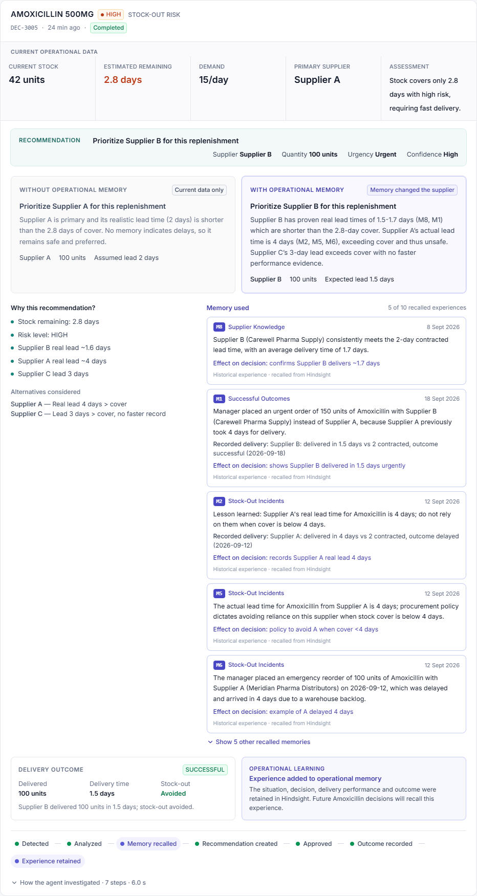
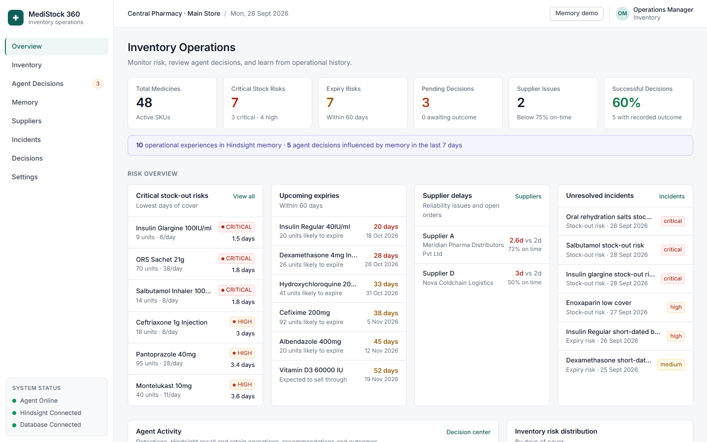
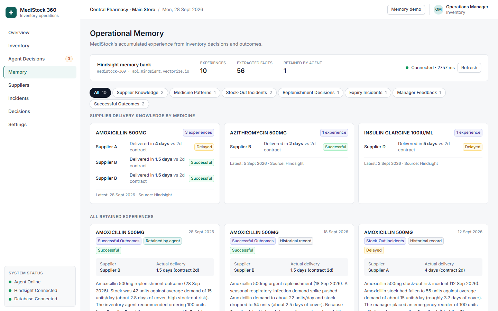
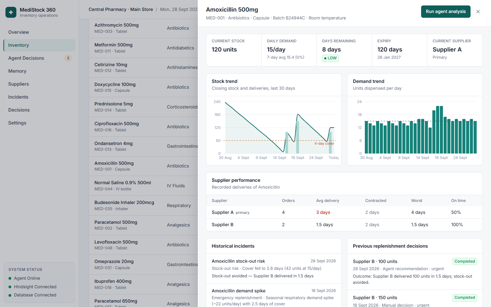
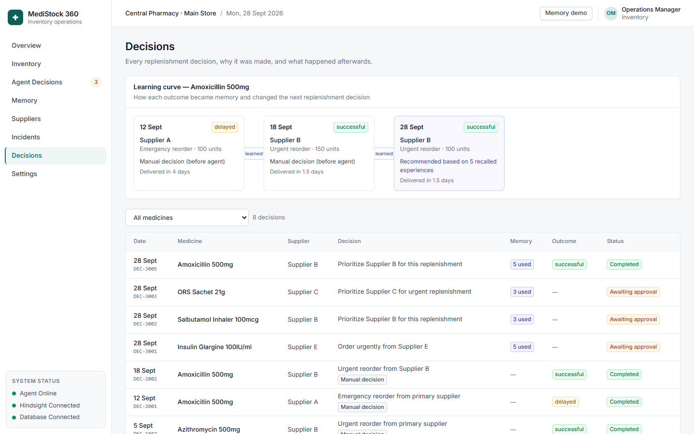
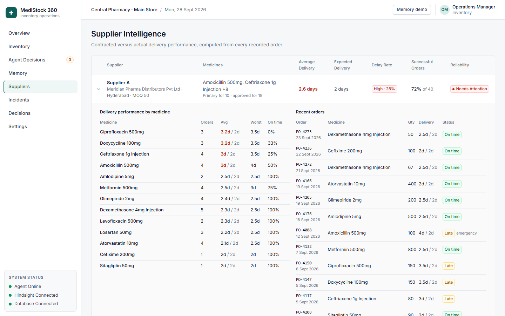
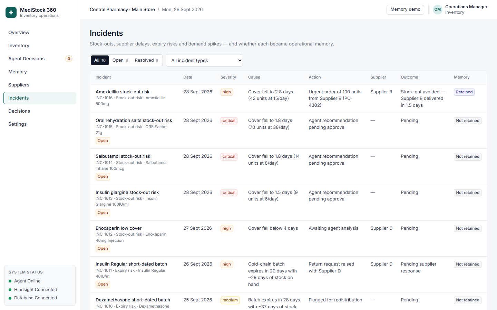

# MediStock 360

**An inventory operations agent with persistent organizational memory for pharmacies.**

Most inventory systems know *what is happening now*. MediStock 360 also knows **what happened before, why a
decision was made, what happened afterwards, and what was learned**, and it uses that experience in the next
replenishment decision.



## Problem

Pharmacy operations managers prevent stock-outs of essential medicines with limited stock, variable demand
and suppliers whose *real* lead times differ from their *contracted* ones. Conventional inventory tools reason
only from the current state: stock on hand, average demand and contract terms. Hard-won lessons, such as
*"Supplier A says 2 days but took 4 the last time we were in trouble"*, stay in people's heads and are lost the
next time the same situation comes up.

## Solution

One workflow, with memory at its centre:

```
CURRENT INVENTORY → RISK DETECTION → AGENT INVESTIGATION → HINDSIGHT RECALL → CONTEXTUAL DECISION
      → MANAGER APPROVAL → OUTCOME → HINDSIGHT RETAIN → BETTER FUTURE DECISION
```

* A deterministic **risk engine** computes days of cover, risk tier, expiry exposure and supplier performance.
* The **Inventory Decision Agent** investigates each at-risk medicine with backend tools, **recalls relevant
  operational experience from Hindsight**, and produces a structured, validated recommendation.
* The **manager approves, modifies or rejects** it. Approval raises a purchase order.
* The **delivery outcome** is recorded, and a distilled experience (situation → decision → reason → delivery
  performance → outcome → lesson) is **retained in Hindsight**.
* The next similar situation recalls that experience.

There is no chat interface. The agent works inside the inventory workflow.

## Product Workflow

| Screen | What the manager does |
|---|---|
| **Overview** | Sees stock-out risks, expiries, supplier issues, open incidents and live agent activity |
| **Inventory** | Searches, filters and sorts 48 medicines; opens a medicine for trends, supplier performance, incidents, decisions and its Hindsight memories |
| **Agent Decisions** | Runs the agent on flagged medicines; reviews each recommendation (current data, *without* vs *with* memory, memory used, reasoning); approves, modifies or rejects; records delivery outcomes |
| **Memory** | Browses every retained experience and the facts Hindsight extracted; queries Hindsight directly; sees every recall/retain operation |
| **Suppliers · Incidents · Decisions** | Contracted vs actual delivery performance; incident history with memory status; the decision history and learning curve |
| **Memory demo** (top bar) | Guided 9-step walk through the full memory lifecycle on the same services |

## Why Persistent Memory Matters

**Amoxicillin 500mg:** 42 units at 15 units/day is **2.8 days of cover**.

| | Without operational memory | With operational memory (Hindsight) |
|---|---|---|
| Evidence | Stock, demand, contract lead times | The same, **plus** recalled experience |
| Supplier A | Contract says 2 days, so it looks safe | *Previously took **4 days** for Amoxicillin; stock fell to 8 units* |
| Supplier B | Contract says 2 days | *Delivered the last urgent Amoxicillin order in **1.5 days**; stock-out avoided* |
| Recommendation | "Reorder from Supplier A" | **"Prioritize Supplier B for this replenishment"** |

Supplier A's real delivery time (4 days) is longer than the remaining cover (2.8 days), and only the remembered
experience reveals it. Every recommendation is produced twice by the same agent, once with the recalled memories
and once without them, and the UI shows both side by side.

## Architecture

```
┌──────────────────────── frontend (React · TypeScript · Vite · Tailwind) ────────────────────────┐
│ Overview · Inventory · Agent Decisions · Memory · Suppliers · Incidents · Decisions · Settings │
└──────────────────────────────────────────┬──────────────────────────────────────────────────────┘
                                           │ /api
┌──────────────────────────────────── backend (FastAPI) ──────────────────────────────────────────┐
│ api/routes.py            typed REST endpoints, JSON errors (no stack traces)                     │
│ agents/inventory_agent   tool orchestration · validation · approvals · outcomes · retain         │
│ agents/llm.py            Groq, JSON output          prompts/recommendation.py                    │
│ services/risk.py         deterministic risk engine (all arithmetic)                              │
│ database/db.py           SQLite: CURRENT operational state (system of record)                    │
│ hindsight/*              PERSISTENT operational experience ─────────────► Hindsight (Cloud/self) │
│ background.py            risk scan loop · history sync · first-run analysis                      │
└─────────────────────────────────────────────────────────────────────────────────────────────────┘
```

Current operational data (SQLite) and historical experience (Hindsight) are kept separate in code and in the UI.
Each decision card shows a *Current operational data* band and a separate *Memory used* panel.

## Agent Architecture

`POST /api/agent/analyze` runs these tools. Each step is recorded in the decision's trace ("How the agent investigated"):

1. `get_medicine_details()`: inventory record
2. `calculate_stock_risk()`: `days_remaining = current_stock / average_daily_demand`, risk tier, demand trend, expiry
3. `get_supplier_terms()`: approved suppliers, contracted lead times, MOQ, open orders
4. `recall_hindsight_memory()`: relevant experience for this medicine and its suppliers
5. `create_replenishment_recommendation()`: LLM structured output **with** memory, plus a parallel run **without** it
6. `validate_recommendation()`: the business-rule checks below
7. `store_decision()`: pending decision and open incident; waits for the manager

`validate_recommendation()` enforces these rules:

* The supplier must be approved for this medicine.
* Cited memories must exist in the recall.
* The planning lead time comes from memory evidence or the contract, never from the LLM. Each recalled fact
  carries a "recorded delivery" summary of its source experience, and the memories behind the lead times are
  always listed under *Memory used*.
* Quantity = `demand × (lead + target cover) − stock`, rounded up to pack size and MOQ.
* If the proposed supplier's realistic lead time exceeds the remaining cover while a faster approved supplier
  exists, the recommendation is switched, and the switch is recorded.

After the analysis: `approve` / `modify` / `reject`, then `record_replenishment_outcome()`, then `retain_hindsight_memory()`.
The LLM never writes to the database. Without an LLM key, a deterministic, still memory-aware engine is used and
labelled "Rules-based" in the UI. A medicine with an order already in transit cannot be re-analysed until its
outcome is recorded, which prevents duplicate orders.

**Risk rules:** CRITICAL ≤ 2 days · HIGH > 2–4 · MEDIUM > 4–7 · LOW > 7. Tiers use the unrounded value. Expiry risk
uses a configurable threshold (default 60 days) plus units likely to expire. A supplier is at risk when its average
delivery exceeds the contract by more than 25% or its on-time rate falls below 75%.

## Hindsight Integration

Code lives in [`backend/app/hindsight/`](backend/app/hindsight) and uses the official `hindsight-client` SDK (async):

| Module | Responsibility |
|---|---|
| `client.py` | SDK client, bank creation with an operations *mission* and *retain mission*, health check (8 s timeout) |
| `retain.py` | `aretain()` of distilled experiences with `context`, `timestamp`, `document_id`, `tags`, `metadata` |
| `recall.py` | `arecall()` with a query built from the medicine and its suppliers (45 s timeout). Each fact is enriched with its source document's tags and metadata. Selection puts this medicine's experiences first (one fact per experience before any second fact), then at most two supplier-wide and two policy memories, and drops consolidated observations that restate a fact already shown |
| `memory_parser.py` | Typed memory items: clean fact text, category, medicine, supplier, and delivery evidence (medicine-specific first, then supplier-wide) |

**What gets retained:** replenishment outcomes (situation, decision, rationale, supplier, contracted vs actual lead
time, stock-out result, lesson); manager feedback on rejected or modified recommendations; and, on first start,
the historical record: supplier delays, successful emergency orders, an expiry write-off, a cold-chain failure,
a seasonal demand pattern and policy feedback. Raw conversations are never stored.

**Where memory shows up:** *Memory used* cards (what was remembered, when, and how it changed the decision),
*Operational learning* after each outcome, the Memory page (read live from Hindsight), and the activity feed
("Hindsight recall — 3 relevant memories found", "Hindsight retain — new operational experience stored").
If Hindsight is unreachable, the UI says so and the agent decides from current data only. Memory is never faked.

## Memory Lifecycle

```
incident / decision ──► outcome recorded ──► distilled experience ──► Hindsight retain
                                                                            │ fact extraction
                                                                            ▼
next at-risk medicine ──► Hindsight recall ──► memory used ──► changed / confirmed recommendation
```

## Local Setup

Requirements: Python 3.12+, Node.js 20+, a Groq API key and a Hindsight Cloud API key (or a self-hosted Hindsight server).

```powershell
cd backend
python -m venv .venv
.\.venv\Scripts\python.exe -m pip install -r requirements.txt
copy .env.example .env          # add your keys

cd ..\frontend
npm install
```

## Environment Variables

`backend/.env` (template: [`backend/.env.example`](backend/.env.example); `.env` is git-ignored and secrets never reach the browser).

| Variable | Default | Purpose |
|---|---|---|
| `GROQ_API_KEY` | none | LLM for the decision agent (without it: rules-based engine) |
| `GROQ_MODEL` | `openai/gpt-oss-120b` | Groq model id |
| `HINDSIGHT_BASE_URL` | `https://api.hindsight.vectorize.io` | Hindsight Cloud, or e.g. `http://localhost:8888` for self-hosted |
| `HINDSIGHT_API_KEY` | none | Hindsight Cloud API key (not needed for a local server) |
| `HINDSIGHT_BANK_ID` | `medistock-360` | Memory bank for this pharmacy |
| `DATABASE_PATH` | `./data/medistock.db` | SQLite file, created and seeded automatically |

## Running the Application

```powershell
.\start.ps1                      # backend + frontend windows, opens the browser
```

or manually, in two terminals:

```powershell
cd backend;  .\.venv\Scripts\python.exe -m uvicorn app.main:app --port 8000
cd frontend; npm run dev
```

App: http://localhost:5173 · API docs: http://127.0.0.1:8000/docs

On first start the database is seeded: 48 medicines, 6 suppliers, 30 days of stock history, ~150 orders and
12 incidents. The 9 historical experiences are then retained into Hindsight, and the agent analyses three urgent
medicines so the Decision Center has live recommendations. Amoxicillin is left for the demo.

## Demo Scenario (60–180 s)

1. **Overview**: Amoxicillin 500mg is a HIGH stock-out risk (42 units, 15/day, 2.8 days).
2. **Agent Decisions**: in the flagged list, click **Analyze** on Amoxicillin.
3. The card shows **current operational data**, then **Without memory → Supplier A** vs **With memory → Supplier B**,
   labelled "Memory changed the supplier".
4. **Memory used** shows Supplier A's 4-day delay and Supplier B's 1.5-day success, recalled from Hindsight.
5. **Approve** and confirm. A purchase order is raised.
6. **Record outcome**: 100 units in 1.5 days, stock-out avoided. The card shows *Operational learning: experience
   added to operational memory*.
7. **Settings → Simulate demand cycle**, or use **Memory demo** in the top bar for steps 7–9 as a guided flow.
8. **Analyze** Amoxicillin again. The agent recalls and cites both the historical delay and the experience it just retained.
9. **Memory** shows the new experience next to the history, with the facts Hindsight extracted.

*Settings → Reset demo data* restores the dataset and removes demo-retained experiences from Hindsight.

## Testing

```powershell
cd backend
.\.venv\Scripts\python.exe -m pip install -r requirements-dev.txt
.\.venv\Scripts\python.exe -m pytest -q
```

24 tests run the application's real integration code, including the official Hindsight SDK. They use a local
Hindsight-compatible test server ([`tests/fake_hindsight.py`](backend/tests/fake_hindsight.py), used only by the
tests) and the rules-based engine, so they run offline. They cover:

* the full retain → recall → decision change → approve → outcome → retain → recall-both loop
* recall selection on the result shapes Hindsight Cloud returns (consolidated observations, repeated policies)
* manager feedback retention, the supplier-safety validation and duplicate-order protection
* API status codes and validation, Hindsight-down degradation, non-leaking server errors, risk-tier
  boundaries and quantity arithmetic

**Verified live** against Hindsight Cloud and Groq (`openai/gpt-oss-120b`), all 14 checks passing:

* the 9 historical experiences are retained, and the Supplier A delay is recalled at 2.8 days of cover
* the recommendation changes from Supplier A (without memory) to Supplier B (with memory), citing the delay
* approval, then an outcome of 1.5 days / successful, then the new experience retained and readable from Hindsight
* the next similar situation (2.6 days) recalls **and cites both** the historical delay and the new experience

## Screenshots

| | |
|---|---|
|  |  |
|  |  |
|  |  |

## Example Memory

Retained by the agent after the demo outcome (document `outcome-dec-…`, tags `category:successful_outcome`,
`medicine:MED-001`, `supplier:SUP-B`; metadata includes contracted/actual delivery days and outcome):

> Amoxicillin 500mg replenishment outcome (28 Sep 2026). Stock was 42 units against average demand of 15 units/day
> (about 2.8 days of cover, high stock-out risk). The inventory agent recommended ordering 100 units from Supplier B
> and the manager approved it. … Supplier B delivered 100 units of Amoxicillin 500mg in 1.5 days against a contracted
> 2 days. Stock-out avoided. Outcome: successful. Lesson: Supplier B reliably delivered Amoxicillin under urgent
> conditions; it remains the preferred option over Supplier A when Amoxicillin cover is low.

## Tech Stack

React 19 · TypeScript · Vite · Tailwind CSS v4 · TanStack Query · Recharts · FastAPI · SQLite · Groq ·
Hindsight (`hindsight-client`) · pytest

## Project Structure

```
medistock/
├── backend/
│   ├── app/
│   │   ├── api/routes.py        agents/ (inventory_agent.py, llm.py)      prompts/recommendation.py
│   │   ├── services/            risk engine, inventory, overview, memory read-side, demo, events
│   │   ├── hindsight/           client, retain, recall, memory_parser
│   │   ├── database/db.py       models/schemas.py      seed/ (dataset, demo history, seed experiences)
│   │   ├── background.py        main.py
│   ├── tests/                   memory-loop + API tests, Hindsight-compatible test server
│   └── requirements*.txt · .env.example
├── frontend/src/                pages/ · components/ (Layout, MedicineDrawer, decision/*, ui) · lib/
├── docs/screenshots/
└── start.ps1
```

## Limitations

* Synthetic data and a single store; stock and dispensing are not connected to a live POS/ERP feed.
* Delivery outcomes are entered by the manager, not captured from goods-received notes.
* How useful recall is depends on how Hindsight extracts and ranks facts. The app compensates by enriching facts
  with their source document's metadata and by diversifying recalled experiences.
* Groq free tier allows about 8,000 tokens per minute and each analysis uses about 4–5k, so rapid repeated analyses
  wait for the limit (the client retries) or, if still limited, fall back to the rules-based engine. The UI labels this.
* One persona (operations manager); there is no authentication in this local prototype.

## Future Improvements

* Live stock and dispensing feeds; automatic outcome capture from goods-received notes
* Hindsight *mental models* per supplier and per medicine
* Multi-store memory banks with shared supplier knowledge
* Price- and budget-aware recommendations

## Data Safety

Operational inventory data only, all synthetic. No patient names, prescriptions, medical records or clinical advice.
